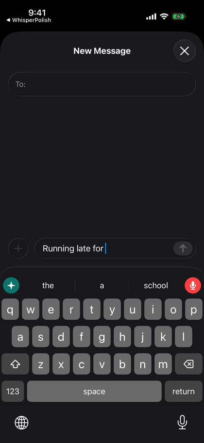
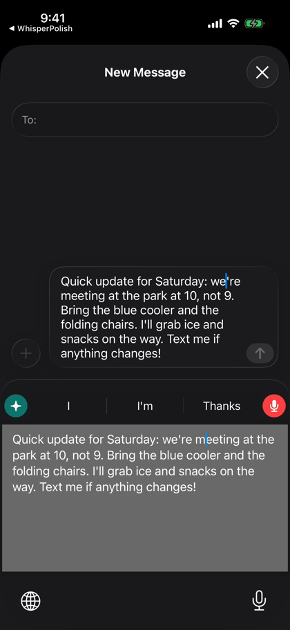

<div align="center">


# Whisper Polish

**An iPhone keyboard with its own AI, running on the phone.**

[**See it in action →**](https://whisper-polish.wooten-labs.com) &nbsp;·&nbsp; made by [Wooten Labs](https://wooten-labs.com)

[](LICENSE)
[](project.yml)
[](#3-polish-in-the-keyboard)

<a href="https://whisper-polish.wooten-labs.com"></a>

</div>

Most third-party iOS keyboards are worse at the basics than Apple's. Whisper Polish tries to be as good as the built-in keyboard at typing, then adds three things no other keyboard does well.

## 1. Its own word prediction



The suggestion bar runs a word model trained for this keyboard, not the system's.

- **A small LSTM trained on public text** ([`scripts/keyboard-model`](scripts/keyboard-model)). Its Float16 weights are memory-mapped, so they fit inside a keyboard extension's tight memory limit.
- **It learns your phrasing on the phone.** A personal trigram model counts which words follow which in what you type, and mixes them into the suggestions. Nothing leaves the phone.
- **It learns where your thumbs land.** Thumbs miss consistently, a little right of one key and low on another. The keyboard learns each key's real target from the words you keep, and autocorrect aims there.

<br clear="right">

## 2. Hold space to move the cursor



Hold the space bar and the keyboard turns into a panel showing your text, wrapped the way it is on screen. Slide your thumb and the caret moves up, down and across lines, and the caret in the app follows.

Apple's keyboard can do this. Most third-party keyboards only move left and right, if at all, because iOS doesn't let a keyboard see the app's layout. Whisper Polish lays the text out itself ([`TrackpadTextView.swift`](WhisperPolishKeyboard/TrackpadTextView.swift), [`FloatingCursor.swift`](WhisperPolishKeyboard/FloatingCursor.swift)), so the line you steer to is the line you see.

<br clear="right">

## 3. Polish, in the keyboard

<p>

&nbsp;

</p>

Tap the sparkle and your rough text, typed or dictated, is rewritten in the style you choose: an email, a text, a Slack message, bullets, or a style you describe. It drops filler and false starts, keeps the corrected fact ("1 no wait 1:30" becomes 1:30), and keeps names, places and numbers.

It runs **inside the keyboard, on the phone**, with no server and no account:

- **The model:** [Qwen3.5-0.8B](https://huggingface.co/Qwen/Qwen3.5-0.8B), fine-tuned by us for polishing. It's an 812 MB, 8-bit download, made once in the app.
- **The engine:** [llama.cpp](https://github.com/ggml-org/llama.cpp) with Metal, loaded only while Polish runs. A typical note takes 1.5 to 4 seconds on an iPhone Air.

### How we trained it

The training pipeline is in [`scripts/on-device-polish`](scripts/on-device-polish), and every step can be rerun. A cloud model ([GLM-5.2](https://openrouter.ai/z-ai/glm-5.2)) wrote reference polishes, and the small model learned to copy them. The interesting part is what went wrong:

| Round | What changed | Polishes that pass a fact check* |
|---|---|---|
| 2 | 25,000 real and synthetic notes, references from the cloud model | 73 of 110 |
| 3 | We fact-checked the references: 22% invented or changed details, and on garbled YouTube captions 44% did. The small model was learning to make things up. Training only on references that pass fixed most of it. | 85 of 110 |
| 3 + preference | The model wrote 4 versions of 8,000 notes; we trained it toward its faithful versions and away from the ones that invented. | Hard, garbled notes: 58%, up from 48%; invented details down 58% |

\* A separate model checks each polish for invented, changed, dropped or garbled details. It agreed with a stronger model's judgment 86% of the time.

These three rounds cost about $50 in all: cloud-model calls on [OpenRouter](https://openrouter.ai) and an NVIDIA L4 GPU on AWS at $0.80 an hour.

## Also in the app

Whisper Polish began as a voice-note app, and that's still there: record a note, transcribe it on the phone ([WhisperKit](https://github.com/argmaxinc/WhisperKit) or Parakeet), and polish it. Notes stay on the phone in SwiftData.

## Build it

You need macOS with Xcode 26 or newer and [XcodeGen](https://github.com/yonaskolb/XcodeGen) 2.45 or newer.

```sh
git clone https://github.com/jonclegg/whisper-polish.git
cd whisper-polish
brew install xcodegen
mkdir -p Config && touch Config/DevKeys.xcconfig
xcodegen generate
open WhisperPolish.xcodeproj
```

`Config/DevKeys.xcconfig` holds optional developer API keys and is never committed; an empty file builds. [`project.yml`](project.yml) is the source of truth for the Xcode project.

The app runs in the iOS Simulator, Polish included. To try the keyboard there, add it in **Settings › General › Keyboard › Keyboards** and turn on **Allow Full Access**, which Polish needs.

To make the demo video from your own Simulator recordings, see [`docs/media/make-demo-video.sh`](docs/media/make-demo-video.sh).

## Repository map

| Path | What lives there |
|---|---|
| [`WhisperPolishKeyboard/`](WhisperPolishKeyboard/) | The keyboard: layout, prediction, cursor, and Polish |
| [`WhisperPolish/`](WhisperPolish/) | The app: notes, transcription, model download, settings |
| [`scripts/keyboard-model/`](scripts/keyboard-model/) | Training and exporting the word model |
| [`scripts/on-device-polish/`](scripts/on-device-polish/) | Training, fact-checking and judging the Polish model |
| [`Packages/LlamaCpp/`](Packages/LlamaCpp/) | llama.cpp for iPhone and the Simulator |
| [`Tests/`](Tests/) | Unit tests and opt-in integration tests |
| [`backend/`](backend/) | The optional cloud polish API |

## Contributing

Issues and pull requests are welcome. Keep changes focused, include tests when behavior changes, and never commit API keys or credentials. Please report security issues privately as described in [`SECURITY.md`](SECURITY.md).

## License

Whisper Polish is released under the [Apache License 2.0](LICENSE). Qwen3.5 and llama.cpp keep their own licenses (Apache 2.0 and MIT).
