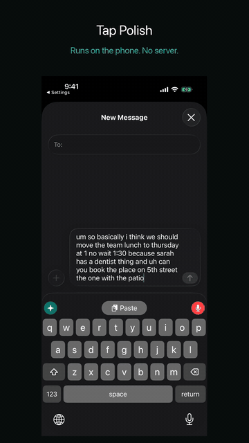
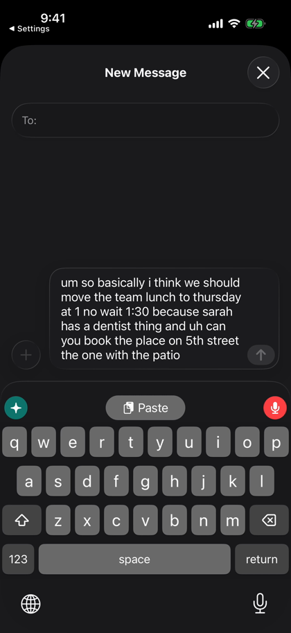
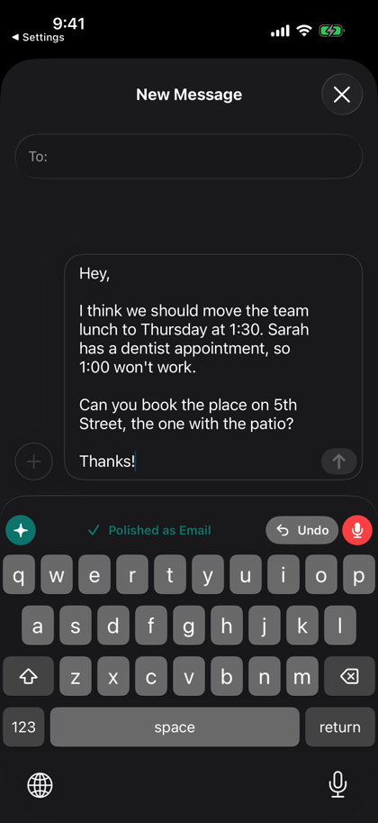

<div align="center">


# Whisper Polish

An iPhone keyboard that can rewrite what you typed. The model runs on the phone.

[Website](https://whisper-polish.wooten-labs.com) &nbsp;·&nbsp; made by [Wooten Labs](https://wooten-labs.com)

<a href="https://whisper-polish.wooten-labs.com"></a>

</div>

It's free and open source. This repo has the keyboard, the app, and the scripts that trained both of its models.

## What it does

**Polish.** Type or dictate something rough, tap the button, and it's rewritten as an email, a text, a Slack message or bullets. It takes out the "um"s and false starts. If you said "at 1, no wait, 1:30", it keeps 1:30. This happens in the keyboard, on the phone. There's no server and no account.

<p>

&nbsp;

</p>

**Hold space to move the cursor.** The keyboard shows your text, and you slide your thumb to move the caret, up and down as well as sideways. Apple's keyboard does this. Other keyboards mostly can't, because iOS doesn't tell a keyboard where the lines are. This one lays the text out itself.

**Its own word prediction.** The suggestions come from a small model trained for this keyboard, not from iOS. It also learns the words you use and where your thumbs land on each key. That stays on the phone.

## How Polish was trained

This is the part I'd want to read, so here's all of it. The scripts are in [`scripts/on-device-polish`](scripts/on-device-polish). The whole thing cost about $50.

### The setup

- **Model:** [Qwen3.5-0.8B](https://huggingface.co/Qwen/Qwen3.5-0.8B). A keyboard extension gets very little memory (I saw it killed around 177 MB), and Polish has to finish in about 5 seconds, so nothing bigger was an option.
- **Teacher:** GLM-5.2 through OpenRouter. It polishes a rough note, and the small model is trained to give the same answer. This is plain distillation.
- **Inputs:** about 25,000 rough notes. Real speech from [AMI](https://groups.inf.ed.ac.uk/ami/corpus/) meeting transcripts and [YODAS](https://huggingface.co/datasets/espnet/yodas) YouTube captions, plus messages written by Claude Haiku to sound dictated. Some get roughed up with fake thumb typos ([`typing_noise.py`](scripts/on-device-polish/typing_noise.py)).
- **Prompt:** no system prompt. Just `Style: <instruction>` and `Text: <the note>`. A small model doesn't need a page of rules if it's trained on the task.
- **Training:** a full fine-tune, not LoRA. Learning rate 3e-5, cosine schedule, batch 32, loss on the answer only. About 3.5 hours per pass on one NVIDIA L4 on AWS, at $0.80 an hour ([`cloud/train.py`](scripts/on-device-polish/cloud/train.py)).
- **Grading:** 110 held-out notes. Claude compares the small model's polish with the teacher's, blind, and picks a winner ([`judge.py`](scripts/on-device-polish/judge.py)).

### What went wrong: it made things up

The first good version read well, but it invented things. You'd dictate a note and get back a sentence you never said.

So I wrote a fact checker ([`check_references.py`](scripts/on-device-polish/check_references.py)). Claude Haiku reads the note and the polish, and rejects the polish if it adds something, changes a name or number, keeps a nonsense word, or drops a fact.

Then I ran it on the *teacher's* answers, the ones the model was trained on. **22% of them failed.** On the garbled YouTube captions, 44% failed. When the input was a mess, the teacher filled the gaps with something that sounded right, and the small model learned that filling gaps is the job.

### Fix 1: throw out the bad training answers

I dropped every training answer that failed the check, asked the teacher again with stricter instructions, checked those, and trained on what passed: 34,897 examples, two passes.

| | Pass the fact check (110 test notes) |
|---|---|
| Before | 73 |
| After | 85 |
| The teacher itself | 89 |

The stricter instructions on their own did almost nothing (the teacher went from 89 to 87). Filtering is what worked.

### Fix 2: train it on its own mistakes

A student doesn't usually beat its teacher, and it was nearly level at 85 against 89. To go further I used the model's own output.

1. The model polishes 8,000 notes, four times each, at temperature 0.8. That's 32,000 polishes. With [vLLM](https://github.com/vllm-project/vllm) it took 20 minutes on the L4.
2. The fact checker marks each one. 69% passed.
3. For every note where one version passed and another failed, that's a pair: prefer this one, not that one. 5,006 pairs.
4. Train on the pairs with DPO ([`cloud/train_dpo.py`](scripts/on-device-polish/cloud/train_dpo.py)), plus a little ordinary loss on the good version so the writing doesn't drift.

On 492 hard notes it had never seen:

| | Before | After |
|---|---|---|
| Pass the fact check | 48% | 58% |
| Invented something | 89 | 37 |
| Changed a fact | 81 | 60 |
| Left a garbled word in | 77 | 102 |

It invents less than half as often. The cost is the last row: when it can't work out a garbled word, it now leaves it alone instead of guessing. I think that's the better way to fail, because you can see it.

### Things I got wrong

- **The first DPO run did nothing.** I used a learning rate of 1e-6 to be careful. After training, the model preferred the good polish 48.5% of the time, a coin flip. At 5e-6 it reached 66%.
- **The checker is wrong sometimes.** I had a stronger model re-check 100 of its verdicts. They agreed on 86. That's fine for comparing two versions of the same note, but it's not a ground truth.
- **A model can cheat a fact checker** by copying the input or writing less. The pairs only count a version as good if it actually changed the text and didn't just cut it short ([`make_pairs.py`](scripts/on-device-polish/make_pairs.py)).
- **I shut down the GPU box with the only copy of the weights on it.** All I had was the phone-format GGUF file. [`rebuild_hf.py`](scripts/on-device-polish/rebuild_hf.py) turns a GGUF back into trainable weights by running llama.cpp's converter on tensors filled with their own indexes, to see where each number ends up.
- **It still isn't as good as the teacher at writing.** The judge prefers the teacher's version about 70% of the time. And custom styles like "translate to Spanish" mostly don't work.

### Running it in a keyboard

- [llama.cpp](https://github.com/ggml-org/llama.cpp) with Metal. The model is an 812 MB 8-bit GGUF, memory-mapped, so the weights don't count against the keyboard's memory.
- It's loaded for each polish and freed after. A typical note takes 1.5 to 4 seconds on an iPhone Air.
- The first polish after downloading took 12 seconds, because iOS was paging the file in 16 KB at a time. Reading the file once, start to finish, before loading fixed it ([`OnDevicePolisher.swift`](WhisperPolishKeyboard/OnDevicePolisher.swift)).

## The word prediction model

A one-layer LSTM over words, trained on public text ([`scripts/keyboard-model`](scripts/keyboard-model)). It's a 32 MB file of Float16 weights, memory-mapped. On top of it, the keyboard counts your own word pairs and triples on the phone ([`PersonalModel.swift`](WhisperPolishKeyboard/PersonalModel.swift)) and learns where your touches land around each key ([`TouchAdaptation.swift`](WhisperPolishKeyboard/TouchAdaptation.swift)).

## Build it

You need Xcode 26 and [XcodeGen](https://github.com/yonaskolb/XcodeGen).

```sh
git clone https://github.com/jonclegg/whisper-polish.git
cd whisper-polish
brew install xcodegen
mkdir -p Config && touch Config/DevKeys.xcconfig
xcodegen generate
open WhisperPolish.xcodeproj
```

It runs in the Simulator too. Add the keyboard in Settings › General › Keyboard › Keyboards and turn on Allow Full Access, which Polish needs.

The app also records and transcribes voice notes on the phone. That's where the project started.

## License

[Apache 2.0](LICENSE). Qwen3.5 is Apache 2.0 and llama.cpp is MIT.
